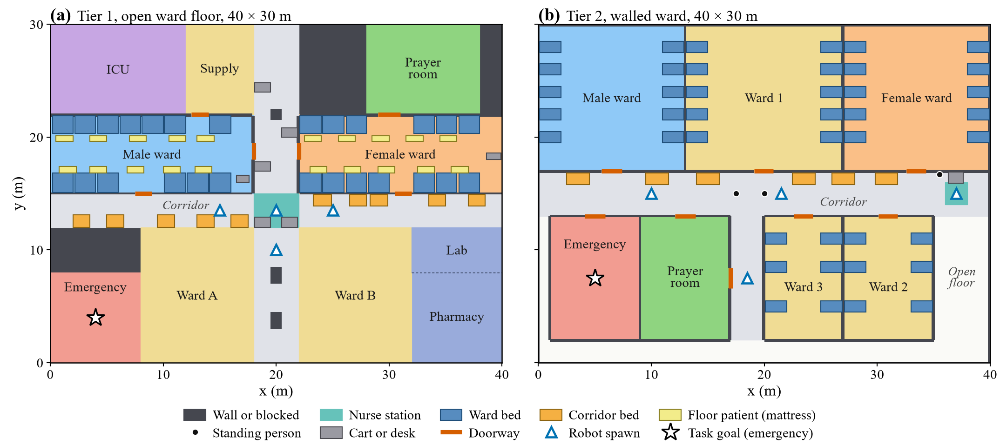
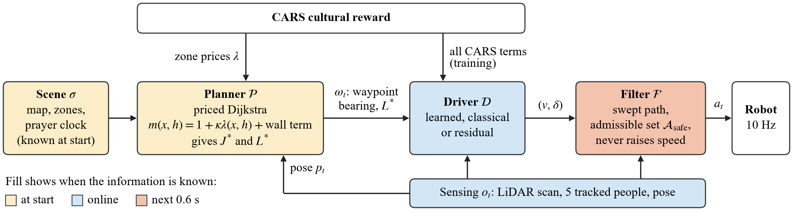
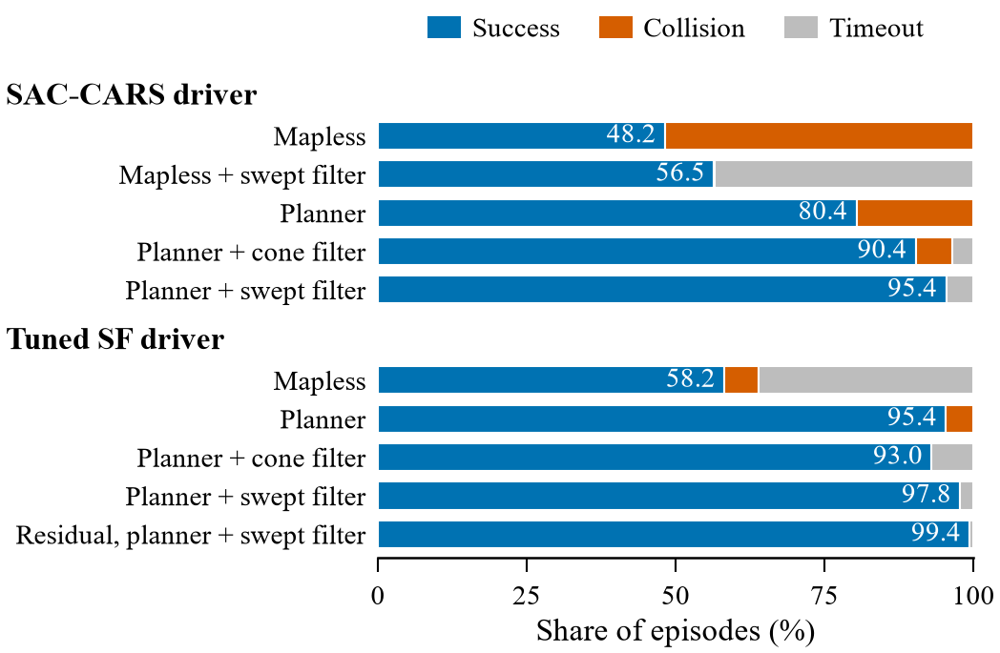
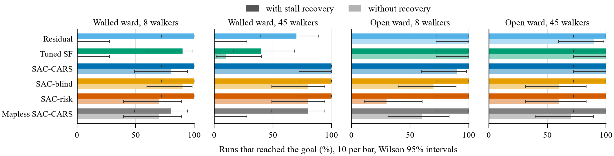
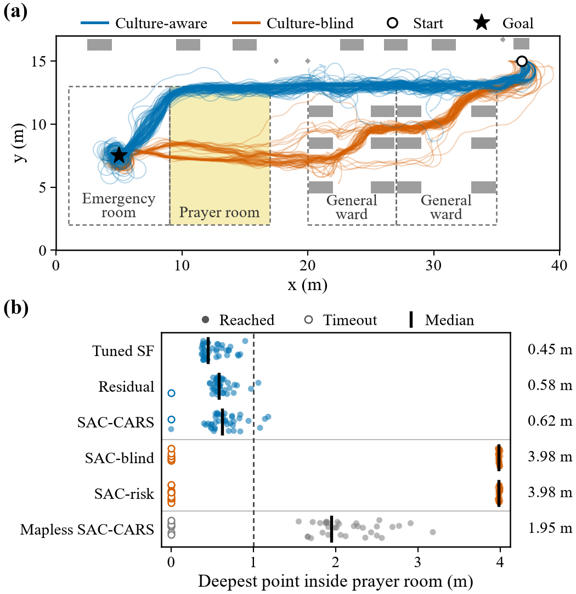

# LMIC-HospitalNav

**An open benchmark and a culture-aware navigation stack for service robots in overcrowded LMIC hospitals**

Public hospitals in low- and middle-income countries (LMICs) run far beyond capacity. Dhaka Medical College Hospital (DMCH) has held about 4,300 inpatients in 2,600 beds, and Rajshahi Medical College Hospital (RMCH) often holds more than 5,000 patients in 1,200 beds. A delivery robot in such a hospital must cross packed corridors on time, respect prayer rooms and gender-segregated wards, and never touch anyone.

This repository contains everything behind our study of that problem:

* **LMIC-HospitalNav-v1**, an open Gymnasium benchmark based on data from DMCH and RMCH, with two floor plans, up to 74 pedestrians of four kinds, five logistics tasks with deadlines and an Ackermann (car-like) robot.
* **A three-level navigation stack**: a planner that prices cultural zones, a local driver (learned, classical or residual) that handles people, and a swept-path safety filter that vetoes any command whose path would touch someone.
* **The full training campaign** (96 runs), the trained models, per-episode results, a robustness suite, and a **480-run Gazebo study** with the real MentorPi robot model in ROS 2.



---

## Contents

1. [The problem in one paragraph](#the-problem-in-one-paragraph)
2. [The benchmark](#the-benchmark)
3. [The navigation stack](#the-navigation-stack)
4. [Main results](#main-results)
5. [Quick start](#quick-start)
6. [Trained models](#trained-models)
7. [Data in this repository](#data-in-this-repository)
8. [Repository layout](#repository-layout)
9. [Limitations](#limitations)
10. [Cultural rules and stakeholder validation](#cultural-rules-and-stakeholder-validation)
11. [Citation, license and third-party assets](#citation-license-and-third-party-assets)

---

## The problem in one paragraph

We call it the **price-and-veto problem**. The robot has four duties: reach the goal in time, respect cultural zones, keep a polite distance from people, and never touch anyone. We sort each duty by two questions. *When does the robot know what the duty depends on?* The floor plan, the zones and the prayer timetable are known before the robot moves, but people are only seen through its sensors. *May the duty be traded against progress?* Cultural norms must be tradeable, because two of the five tasks end inside a gendered ward, so a ban would make them impossible. Each norm therefore gets a **posted price** per metre that a hospital can read and change. Contact cannot be traded, so it gets a **veto**. The answers decide which level of the stack handles each duty.

## The benchmark

| | Tier 1: open ward floor | Tier 2: walled ward |
|---|---|---|
| Config | `configs/dmch_hospital.yaml` | `configs/hospital_v4.yaml` |
| Layout | Open floor around two crossing corridors, walled male and female wards, corridor beds and floor mattresses | Seven walled rooms off a 4 m corridor, doors 1.7 to 1.8 m wide, a prayer room with two doors |
| Cultural tension | Gendered wards and attendants along routes | The shortest route for two tasks runs through the prayer room |
| Link to deployment | Grounded in DMCH and RMCH data | Built from the same layout file as the Gazebo world |

Shared by both tiers:

* **Floor:** 40 x 30 m on a 0.1 m grid.
* **Pedestrians:** 23, 45 or 74 people (staff, patients, family attendants in groups of two to four, wheelchair users) driven by an anisotropic social force model. Pedestrians step aside for the robot and never enter its contact ring, so every contact is caused by the robot.
* **Robot:** Ackermann chassis (wheelbase 0.20 m, steering within plus or minus 30 degrees, speed from -0.3 to 0.8 m/s). It cannot turn on the spot.
* **Observation:** 90 values (48-ray 360 degree LiDAR, robot state, the five nearest people, goal or planner waypoint, and a 14-value context).
* **Tasks:** STAT medicine, nurse call, specimen, restock and idle return, each with an urgency and a deadline.
* **Metrics:** success rate (SR), collision and timeout shares, cultural violation rate (CVR), CVR on the STAT task (CVR_STAT), social violation rate (SVR), time to goal.
* **Clock:** a ward clock with five daily prayer windows, so a prayer time can start or end during a trip.

## The navigation stack



* **Planner.** Dijkstra cost-to-go on the robot-inflated grid. A metre in a zone costs `1 + kappa * lambda(x, h)` corridor metres, where `lambda` is the cultural charge of the reward, converted to metres of progress (0.83 in the prayer room during prayer, 0.25 at other hours, 0.042 in a gendered ward). We use `kappa = 3`. The planner hands the driver a waypoint up to 2.5 m ahead and the remaining route length. Code: `experiments/planner/planner.py`, `experiments/planner/patch.py`.
* **Local drivers.** SAC, TD3 and PPO trained with the CARS reward (Culture-Aware Reward Shaping), classical controllers (stock and tuned social force, ORCA, pure pursuit, A*), and a **residual** SAC policy that corrects the tuned social-force driver: `a = clip(a_SF + 0.5 * a_pi)`. Code: `train/`, `rewards/`, `scripts/eval_classical_v5.py`, `experiments/planner/residual.py`, `experiments/planner/orca.py`.
* **Swept-path filter.** For the commanded steering angle it computes how far the robot body can travel along its arc before it meets a LiDAR return or a person moved up to 0.6 s ahead, then caps the speed so the robot stops in time. If the arc is blocked it tries nearby steering angles. It never raises speed. It has no formal guarantee. We test it and break its assumptions on purpose. Code: `experiments/planner/arc_shield.py`. The older forward-cone filter is in `baselines/safety_shield.py`.

## Main results

All benchmark numbers come from the final campaign `runs_v5`: 96 runs of 2 million steps, 5 seeds for the main agents, final checkpoints, 500 evaluation episodes per run on identical episode seeds. Tier 2 unless stated.

**Local drivers on the shared planner** (SR and collision in %, swept filter adds the timeout share):

| Driver | SR, no filter | Collisions, no filter | SR, swept filter | Timeouts, swept filter |
|---|---|---|---|---|
| Mapless SAC-CARS (no planner) | 48.2 | 51.8 | 56.5 | 43.5 |
| Stock social force | 6.0 | 0.2 | 6.4 | 93.6 |
| Pure pursuit | 37.0 | 63.0 | 79.6 | 20.4 |
| ORCA | 66.8 | 33.2 | 74.2 | 25.8 |
| TD3-CARS | 65.0 | 32.0 | 67.2 | 32.8 |
| PPO-CARS (library defaults) | 0.0 | 56.9 | 0.0 | 100.0 |
| SAC-CARS | 80.4 | 19.6 | 95.4 | 4.6 |
| SAC-blind (culture-blind) | 84.2 | 15.8 | 96.1 | 3.9 |
| Tuned social force | 95.4 | 4.6 | 97.8 | 2.2 |
| **Residual SAC on tuned social force** | 94.0 | 6.0 | **99.4** | 0.6 |



**Ablation, one change at a time** (SAC-CARS with `kappa = 3` and the swept filter, Tier 2):

| Change | SR | Collisions | CVR_STAT |
|---|---|---|---|
| None (full stack) | 95.4 | 0.0 | 0.002 |
| No planner | 56.5 | 0.04 | 0.231 |
| No filter | 80.4 | 19.6 | 0.001 |
| Cone filter instead of swept | 90.4 | 6.0 | 0.002 |
| Geometric planner (`kappa = 0`) | 95.4 | 0.0 | 0.080 |
| Culture-blind reward | 93.9 | 0.0 | 0.005 |
| Learned reward weights | 94.8 | 0.0 | 0.002 |
| Tuned social-force driver | 97.8 | 0.0 | 0.000 |
| Residual driver | 99.4 | 0.0 | 0.000 |

What the results show:

* **Routing is the main obstacle.** The planner lifts SAC-CARS from 48.2% to 80.4% (2,500 paired episodes, exact McNemar p = 1.2e-142). The gain is 32.2 points on the walled tier and 12.3 on the open tier.
* **Compliance follows the planner's price, not the reward.** On the STAT task the violation rate is 0.001 to 0.003 with the cultural planner and 0.080 to 0.081 with a geometric one, under either reward.
* **Swept geometry decides contact.** With the swept filter, planner-guided drivers that navigate made no contact in 42,500 episodes. PPO-CARS, which never reached a goal, made one contact in 2,500. The forward-cone filter leaves 4.1 to 6.6% collisions.
* **Learned and classical control are complementary.** The tuned social-force driver beats every pure learned driver in the benchmark, and the residual policy on top of it is the strongest driver measured.
* **The approach has a clear boundary.** A crowd that does not give way costs every driver 30 to 40 points, with or without the filter.

**Gazebo study** (gz-sim Harmonic, ROS 2 Jazzy, real MentorPi URDF, LiDAR people tracker, 2 wards x 8 or 45 walkers x 6 drivers x stall recovery on or off x 10 pedestrian seeds):



* With stall recovery, 226 of 240 runs reached the goal. Without it, 151 of 240 did.
* **Route choices transfer.** Culture-aware drivers entered the prayer room to a median depth of 0.45 to 0.62 m, while culture-blind drivers crossed it at 3.98 m (Fisher p = 5.3e-44). The cultural route still skims the room's edge, so a buffer price is needed.
* **The driver ranking does not transfer.** In the walled ward with 45 walkers, SAC-CARS reached the goal in 10 of 10 runs, the residual driver in 7 of 10 and the tuned social-force driver in 4 of 10.



## Quick start

### Install

```bash
git clone https://github.com/Basar-mte/RL-on-Medical-Service-Robot-for-LMIC-Environment.git
cd RL-on-Medical-Service-Robot-for-LMIC-Environment
python -m venv .venv
source .venv/bin/activate            # Windows: .venv\Scripts\activate
pip install -r requirements.txt
```

The campaign was run with Python 3.12, PyTorch 2.11, Stable-Baselines3 2.9 and Gymnasium 1.3.

### Check the environment

```bash
pytest tests/test_env.py -v
python scripts/play.py --density medium     # drive the robot with the arrow keys
```

### Train one agent with the paper's recipe

The final recipe turns reward normalisation off, uses a replay buffer of one million, a learning rate of 1e-4 and one environment per run. The planner is switched on with environment variables.

```bash
export PILOT_NORM_REWARD=0
export PLANNER_MODE=cult PLANNER_RATIO=3.0 PLANNER_L=2.5 PLANNER_DIST=geo PLANNER_PROGRESS=1 PLANNER_LOS=1
python experiments/stability_pilot/patch_sac.py train/train_sac.py \
    --config configs/hospital_v4.yaml --agent fixed_equal --seed 0 --timesteps 2000000 \
    --buffer_size 1000000 --learning_rate 1e-4 --n_envs 1 --device cpu \
    --no_camera --no_check_env --log_dir runs_v5/tier2/fixed_equal_s0
```

Use `PLANNER_MODE=geo` for the culture-blind agents (`--agent vanilla` or `he2025`) and leave the `PLANNER_*` variables unset for a mapless agent. The whole campaign, with every group, seed and evaluation, is driven by `scripts/campaign_v5_stable.py` and `scripts/eval_v5.py`. These two scripts were written for Windows and call `.venv\Scripts\python.exe`, so change the `PY` path on Linux.

### Reproduce the paper's tables and numbers

```bash
python scripts/build_paper_tables.py     # main, driver, compliance, robustness and Gazebo tables
python scripts/audit_paper_numbers.py    # checks the headline numbers against runs_v5/results
```

### Run the stack in Gazebo and ROS 2

See [`ros_sim/README.md`](ros_sim/README.md). It covers the ROS 2 Humble (Gazebo classic) quick start, the gz-sim Harmonic and ROS 2 Jazzy setup used for the paper, every launch argument, the worlds, the pedestrian plugin and how to repeat the 480-run campaign.

## Trained models

`ros_sim/models/` holds the best seed of every trained agent of both tiers (19 models), each with its own `vec_normalize.pkl`. Always keep a model with its own normaliser. The table in [`ros_sim/README.md`](ros_sim/README.md) gives the launch arguments for each model, and `ros_sim/MANIFEST.json` gives file hashes and benchmark scores.

## Data in this repository

* `runs_v5/results/`: aggregated results of the final campaign (`table.json`, `per_task.json`, `per_seed.json` per group), classical drivers, robustness suite, collision anatomy and speed-cap tests, with per-episode records.
* `runs_v5/<group>/<run>/eval_final.json`, `eval_shield.json`, `eval_shield2.json`: the per-episode records of every run without a filter, with the cone filter and with the swept filter (500 episodes each).
* `experiments/planner/results/`: the evaluation-only screen that fixed the planner settings.
* `ros_sim/paper_data/`: all numbers of the Gazebo study as CSV (one row per run, per-configuration statistics, the robot's 10 Hz logs, routes, seeds, crowd statistics, scan-invariance checks, model parameters). See `ros_sim/paper_data/DATA_README.md`.
* `ros_sim/results_summary/`: the Gazebo campaign and repeated-campaign reports.

Not included because of size: the checkpoints and replay buffers of all 96 training runs, the per-run pedestrian logs of the Gazebo study (0.6 GB), the raw Gazebo run folders, renders and videos (about 5 GB). They are available from the authors on request.

## Repository layout

```
configs/                 floor plans of both tiers (YAML)
envs/                    the Gymnasium environment, floor plan and pedestrian model
rewards/                 CARS reward terms, context weight network, REINFORCE trainer
train/                   SAC training script and callbacks
eval/                    evaluation, aggregation and shielded evaluation
baselines/               classical baselines, risk-field reward, attention weighter, cone filter
experiments/planner/     route planner, swept-path filter, residual driver, ORCA, robustness suite
experiments/             earlier and side experiments (stability pilots, TD3, PPO, shield weaning, density, holonomic)
scripts/                 campaign orchestration, classical evaluation, paper tables and audits
runs_v5/results/         aggregated results of the final campaign
ros_sim/                 ROS 2 package, Gazebo plugins and worlds, trained models, Gazebo data
deploy/                  MentorPi deployment guide, older ROS 2 stack, Isaac Sim tools
stakeholder_validation/  questionnaire for hospital stakeholders
docs/                    stakeholder protocol, simulation changelog, README figures
tests/                   environment smoke tests
```

## Limitations

* All benchmark evaluations use the medium crowd of 45 people, one floor plan per tier, and pedestrians that give way to the robot.
* The planner settings, `kappa = 3` included, were fixed on pilot policies with the protocol episode seeds.
* The swept-path filter is tested, not proven.
* The Gazebo study uses ground-truth localisation on a prebuilt map and one route, and the stall recovery is an intervention the benchmark does not have.
* The physical robot has built a map while driven by hand, but it has not yet navigated on its own.

## Cultural rules and stakeholder validation

The cultural rules (a prayer room most sensitive at the five daily prayer times, separate male and female wards, family attendants at the bedside) describe common practice in Bangladeshi public hospitals. We wrote them ourselves, and stakeholders have not yet validated them. We model separate wards as the hospitals run them today and take no position on the practice. All rules sit in one price table and one prayer timetable, so a hospital can inspect and change them without retraining.

The next step is to deploy the stack on the physical MentorPi robot in DMCH and RMCH wards, guided by the opinions of nurses and ward staff, doctors, administrators, imams and prayer-space caretakers, family attendants and patients, after ethics approval. A short questionnaire is ready in `stakeholder_validation/google_form.gs`, and the full protocol is in `docs/stakeholder_validation.md`.

## Citation, license and third-party assets

If you use this benchmark or the navigation stack, please cite it with the metadata in [`CITATION.cff`](CITATION.cff).

The code is released under the [MIT License](LICENSE).

Third-party assets:

* The hospital furniture and people models in `ros_sim/hospitalnav_deploy/meshes/fuel/` come from the Open Robotics collection on Gazebo Fuel. See `ATTRIBUTION.md` in that folder.
* The Hiwonder MentorPi CAD meshes are **not** included. To use the real robot model (`urdf/mentorpi_real.urdf`) or the Isaac Sim robot, copy the vendor meshes into the `meshes/acker/` folders as explained in the `README.md` files there. The simplified robot model `urdf/hospitalnav_robot.urdf` needs no extra files.

Contact: Md. Abul Basar Roky, Department of Mechatronics Engineering, Rajshahi University of Engineering & Technology, Bangladesh (m.a.basar.mte@gmail.com).
